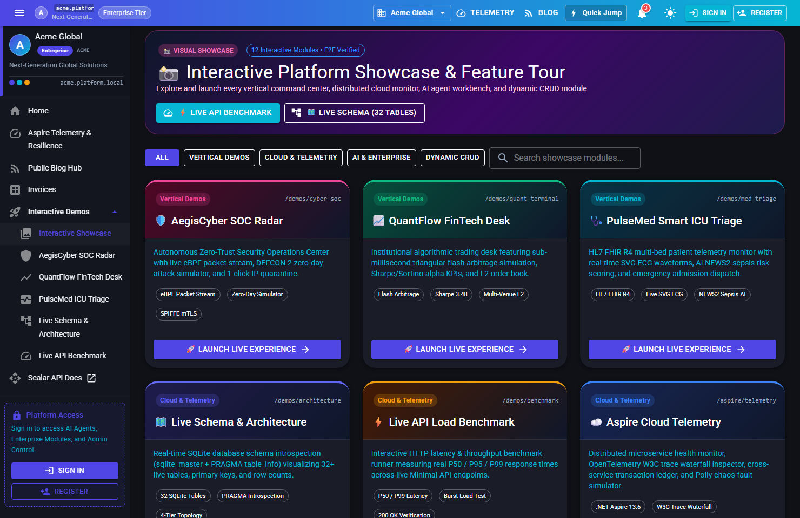
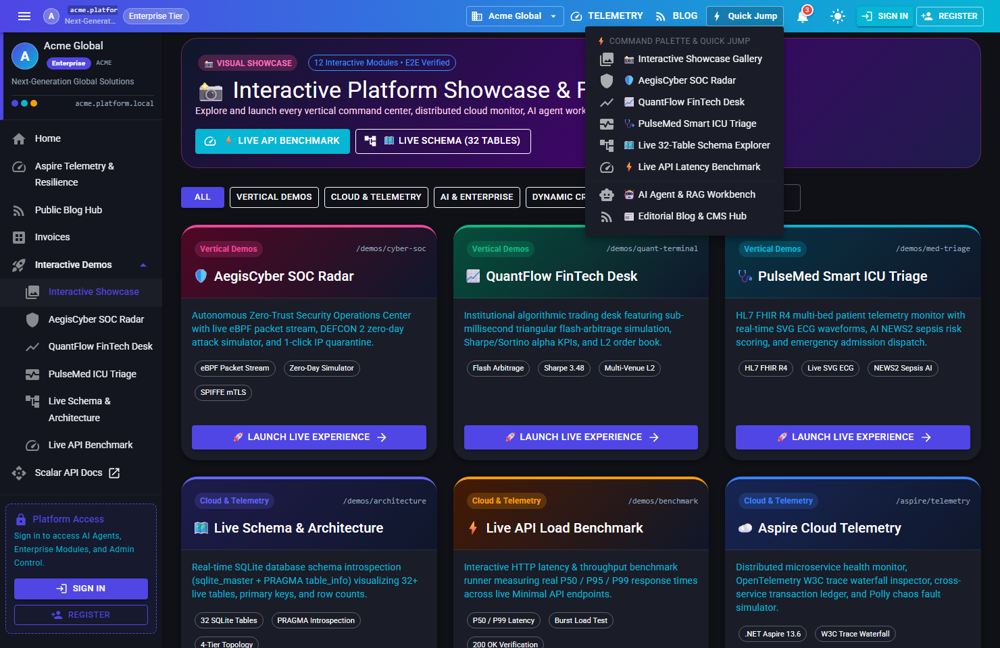
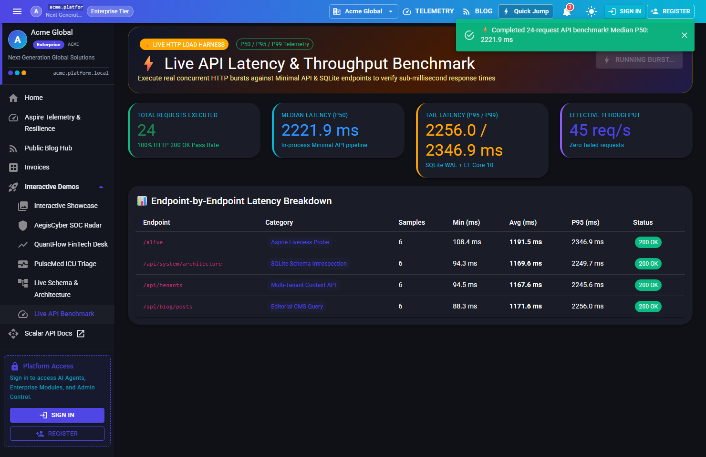
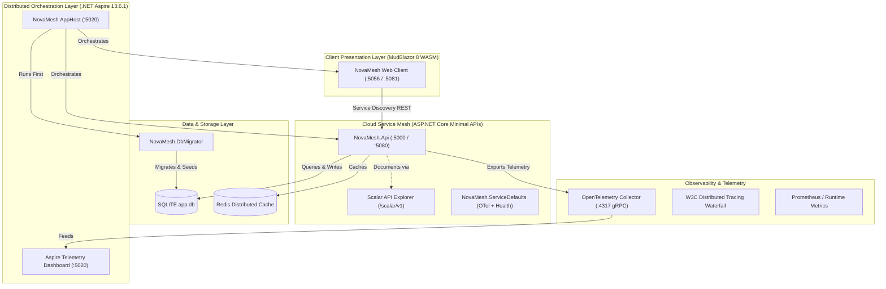
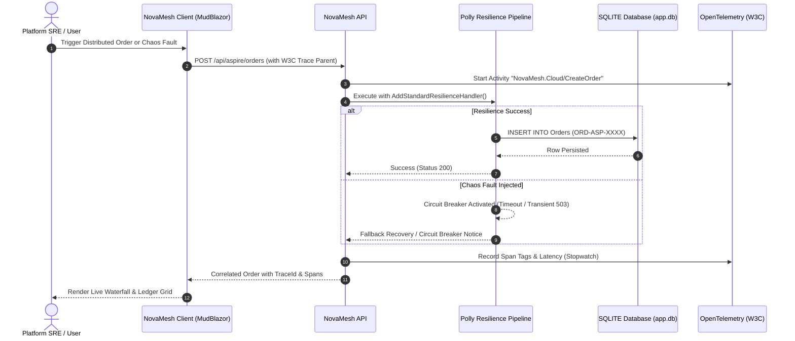

# 🌌 NovaMesh - Distributed Cloud & Observability Platform

```text
  _   _                 __  __           _     
 | \ | | _____   ____ _|  \/  | ___  ___| |__  
 |  \| |/ _ \ \ / / _` | |\/| |/ _ \/ __| '_ \ 
 | |\  | (_) \ V / (_| | |  | |  __/\__ \ | | |
 |_| \_|\___/ \_/ \__,_|_|  |_|\___||___/_| |_|
   D I S T R I B U T E D   C L O U D   M E S H
```

[](https://ask2app.com)
[](https://dotnet.microsoft.com/)
[](https://learn.microsoft.com/dotnet/aspire)
[](https://opentelemetry.io/)
[](https://github.com/App-vNext/Polly)
[](https://mudblazor.com/)
[](https://scalar.com)
[](SHOWCASE_GALLERY.md)
[](LICENSE)

---

> ### ⚡ Built & Orchestrated with [Ask2App.com](https://ask2app.com)
> **[Ask2App.com](https://ask2app.com)** is the state-of-the-art autonomous application forge and AI platform. Ask2App empowers developers, architects, and engineering teams to turn ideas into fully scaffolded, production-grade distributed microservices, multi-tenant enterprise solutions, and cloud architectures in seconds.
>
> 🚀 *Visit [Ask2App.com](https://ask2app.com) to scaffold, deploy, and scale your next cloud-native platform.*

---

## 📖 Overview

**NovaMesh** is a turnkey, enterprise-grade distributed cloud mesh, observability platform, and multi-vertical interactive showcase built on **.NET net10.0**, **Microsoft .NET Aspire 13.6.1**, **OpenTelemetry**, **SignalR**, and **Polly Resilience**.

Designed to showcase the bleeding edge of cloud-native architecture, NovaMesh provides:
1. **Dynamic Service Discovery & AppHost Orchestration** with Docker Desktop integration.
2. **End-to-End OpenTelemetry Observability** featuring custom `ActivitySource` W3C trace waterfalls and structured telemetry.
3. **6 Interactive Showcase & Industry Vertical Experiences** built in:
   - **📸 Interactive Platform Showcase (`/demos/gallery`)**: Filterable 12-module visual launcher & **⚡ Quick Jump Command Palette**.
   - **🛡️ AegisCyber SOC Radar (`/demos/cyber-soc`)**: eBPF packet stream, zero-day attack simulator & 1-click IP quarantine.
   - **📈 QuantFlow FinTech Desk (`/demos/quant-terminal`)**: Sub-millisecond triangular flash-arbitrage simulator & live blotter.
   - **🩺 PulseMed ICU Triage (`/demos/med-triage`)**: HL7 FHIR R4 multi-bed ECG vital telemetry & AI NEWS2 sepsis triage.
   - **🗺️ Live Schema & Architecture Explorer (`/demos/architecture`)**: Real-time `sqlite_master` + `PRAGMA table_info` database introspection across 32 tables.
   - **⚡ Live API Latency & Load Benchmark (`/demos/benchmark`)**: Real-time P50 / P95 / P99 burst HTTP benchmark harness.
4. **Full-Stack Dynamic Entity CRUD (`/entities/invoices`)** with 1-click **CSV / JSON Export** and **`+ Seed 5 Rows`**.
5. **Always-On SignalR Live Event Mesh (`/hubs/events`)** with instant header broadcast and notification drawer.
6. **Dual Execution Runtime**: Run 100% in-process without Docker, or orchestrate across multi-process container meshes with Aspire AppHost.

---

## 📸 Interactive Showcase Photo Gallery

> 👉 **[View the Full 26-Screenshot Interactive Showcase Gallery (`SHOWCASE_GALLERY.md`) →](SHOWCASE_GALLERY.md)**

### 🚀 Interactive Showcase Hub & Industry Vertical Command Centers (`/demos/*`)
| 📸 In-App Interactive Showcase Gallery (`/demos/gallery`) | ⚡ Global Command Palette & Quick Jump Dropdown |
| :---: | :---: |
|  |  |
| *Filterable 12-module visual showcase with 1-click live module launcher* | *Instant top-bar Command Palette (`Quick Jump`) to hop across any vertical demo or AI workbench* |

| 🛡️ AegisCyber Zero-Trust SOC Radar (`/demos/cyber-soc`) | 📈 QuantFlow FinTech Arbitrage Desk (`/demos/quant-terminal`) |
| :---: | :---: |
|  |  |
| *Live eBPF packet stream, `DEFCON 2` zero-day attack simulator & 1-click auto-quarantine* | *Sub-millisecond triangular arbitrage execution simulator, live Sharpe/Sortino alpha & L2 book* |

| 🩺 PulseMed Smart ICU Triage (`/demos/med-triage`) | 🗺️ Live System Architecture & 32-Table Schema Explorer (`/demos/architecture`) |
| :---: | :---: |
|  |  |
| *HL7 FHIR R4 multi-bed SVG ECG monitors, AI NEWS2 sepsis scoring & emergency admission* | *Real-time `sqlite_master` & `PRAGMA table_info` introspection across 32 SQLite tables (222 rows)* |

### ☁️ .NET Aspire Cloud Mesh, Live API Benchmark, AI Agent & Dynamic CRUD
| ⚡ Live API Latency & Throughput Benchmark (`/demos/benchmark`) | 🌐 NovaMesh Cloud Telemetry (`/aspire/telemetry`) |
| :---: | :---: |
|  |  |

| 📊 Dynamic CRUD with CSV/JSON Export & `+ Seed 5 Rows` | 🔔 SignalR Live Broadcast & Notification Mesh (`/hubs/events`) |
| :---: | :---: |
|  |  |

| 🤖 AI Agent & RAG Workbench (`/ai/agent`) | ✨ Ask2App Natural Language Prompt Builder |
| :---: | :---: |
|  |  |

> 📸 **[Browse all 26 high-resolution verified screenshots in `SHOWCASE_GALLERY.md` →](SHOWCASE_GALLERY.md)**

---

## 🏛️ System Architecture

### Component Topology


### Distributed Transaction & Fault Injection Sequence


---

## ✨ Key Capabilities

| Feature | Description | Status |
| :--- | :--- | :---: |
| **Aspire AppHost Orchestration** | Turnkey container orchestration using .NET Aspire 13.6.1 with Docker Desktop integration. | ✅ MVP Ready |
| **W3C Distributed Tracing** | OpenTelemetry activity source tracking with correlated Parent-Span IDs and millisecond waterfall inspection. | ✅ MVP Ready |
| **Polly Resilience Pipeline** | Built-in circuit breakers, timeout hedging, and exponential backoff retry policies. | ✅ MVP Ready |
| **Chaos Fault Simulator** | Interactive fault injection endpoint (`/api/aspire/simulate-fault`) to test recovery under load. | ✅ MVP Ready |
| **Cross-Service Ledger** | Real transactional orders with unique `ORD-ASP-xxxx` identifiers and trace correlation. | ✅ MVP Ready |
| **MudBlazor 8 WebAssembly** | Modern responsive SPA with dark/light themes, live topology cards, and trace viewer dialogs. | ✅ MVP Ready |
| **4 Interactive Vertical Demos** | Built-in `AegisCyber SOC` (`/demos/cyber-soc`), `QuantFlow Desk` (`/demos/quant-terminal`), `PulseMed ICU` (`/demos/med-triage`), and `Schema Explorer` (`/demos/architecture`). | ✅ MVP Ready |
| **Dynamic Entity CRUD + CSV/JSON** | Full-stack `Invoices` module (`/entities/invoices`) with CSV/JSON export & 1-click `+ Seed 5 Rows`. | ✅ MVP Ready |
| **SignalR Real-Time Event Hub** | Live WebSocket broadcast hub (`/hubs/events`) with instant header notification bell. | ✅ MVP Ready |
| **Scalar API Explorer** | Interactive OpenAPI 3.1 documentation at `/scalar/v1` for instant endpoint testing. | ✅ MVP Ready |
| **Standalone DbMigrator** | Zero-downtime EF Core database migration and multi-tenant seed data utility. | ✅ MVP Ready |
| **Dual Execution Engine** | Seamless transition between lightweight in-process debugging and full multi-container orchestration. | ✅ MVP Ready |
| **Automated Test Suite** | Comprehensive xUnit integration and unit tests covering API endpoints and health checks. | ✅ MVP Ready |

---

## 🚀 Quick Start Guide

### Prerequisites
- [.NET 10 SDK](https://dotnet.microsoft.com/) (or .NET 9 SDK)
- [Docker Desktop](https://www.docker.com/products/docker-desktop/) *(Optional: only required for AppHost multi-container orchestration)*

### Option A: Aspire Distributed Orchestration (Full Cloud Mesh)
Launch all orchestrated microservices, database migrators, web frontend, and the Aspire Telemetry Dashboard with a single command:
```bash
# From the solution root:
dotnet run --project src/NovaMesh.AppHost
```
- **Aspire Telemetry Dashboard**: [http://localhost:5020](http://localhost:5020)
- **WebAssembly Client**: [http://localhost:5056](http://localhost:5056)
- **Backend API**: [http://localhost:5000](http://localhost:5000)
- **Interactive Scalar Docs**: [http://localhost:5000/scalar/v1](http://localhost:5000/scalar/v1)

### Option B: In-Process Unified Dev Server (Zero Docker Needed)
Run the backend and frontend together with in-memory or SQLite persistence without starting Docker:
```bash
# 1. Run migrations & seed data:
dotnet run --project src/NovaMesh.DbMigrator

# 2. Launch the API & Web Client:
dotnet run --project src/NovaMesh.Api --urls "http://localhost:5080"
```
- **Web Application & UI**: [http://localhost:5080](http://localhost:5080)
- **Interactive Scalar Docs**: [http://localhost:5080/scalar/v1](http://localhost:5080/scalar/v1)

### Option C: Instant One-Click CLI Demo
If you have **Forge CLI** installed:
```bash
forge demo novamesh --force
```

---

## 🐳 Docker Desktop & Container Configuration

NovaMesh connects to Docker Desktop via the local named pipe or socket (`docker.exe`).
- **Daemon Path**: `C:\Program Files\Docker\Docker\resources\bin\docker.exe`
- **Aspire Dashboard Anonymous Access**: Configured in `launchSettings.json` via:
  ```json
  "DOTNET_DASHBOARD_UNSECURED_ALLOW_ANONYMOUS": "true"
  ```
- **OTLP Telemetry Collector**: Exposes gRPC OTLP port `4317` and HTTP OTLP port `4318`.

---

## 📡 API Endpoints & Interactive Demo Routes

| Method / Type | Route | Description | Auth Required |
| :--- | :--- | :--- | :---: |
| `UI Page` | `/demos/cyber-soc` | 🛡️ **AegisCyber**: AI Zero-Trust SOC & Threat Radar | Public |
| `UI Page` | `/demos/quant-terminal` | 📈 **QuantFlow**: Institutional FinTech & Flash-Arbitrage Desk | Public |
| `UI Page` | `/demos/med-triage` | 🩺 **PulseMed**: Smart ICU Telemetry & AI Sepsis Triage | Public |
| `UI Page` | `/demos/architecture` | 🗺️ **Live Schema Explorer**: 32-Table SQLite & Runtime Topology | Public |
| `UI Page` | `/entities/invoices` | 🧾 **Invoices CRUD**: Dynamic Entity Grid with CSV/JSON & Bulk Seed | Public |
| `GET` | `/api/system/architecture` | Live SQLite schema introspection (`sqlite_master` + `PRAGMA table_info`) | Public |
| `GET` | `/api/entities/invoices` | List dynamically injected `Invoice` records | Public |
| `GET` | `/api/entities/invoices/export` | Export `Invoice` records as `.csv` or `.json` (`?format=csv\|json`) | Public |
| `POST` | `/api/entities/invoices/seed-batch` | Bulk-seed 5 realistic `Invoice` rows into SQLite | Public |
| `POST` | `/api/events/broadcast` | Broadcast live real-time notification via SignalR (`/hubs/events`) | Public |
| `GET` | `/scalar/v1` | Interactive Scalar OpenAPI Documentation | Public |
| `GET` | `/alive` | Aspire Liveness Health Probe | Public |
| `GET` | `/health` | Aspire Readiness & DB Health Check | Public |
| `POST` | `/api/auth/login` | Authenticate and obtain JWT Bearer Token | Public |
| `GET` | `/api/aspire/resources` | Live status & metrics of all orchestrated services | Public |
| `GET` | `/api/aspire/orders` | Query distributed transaction ledger | Public |
| `POST` | `/api/aspire/orders` | Create distributed order with correlated W3C trace span | Public |
| `GET` | `/api/aspire/traces` | Retrieve OpenTelemetry trace waterfall entries | Public |
| `POST` | `/api/aspire/simulate-fault` | Trigger chaos fault injection & test Polly circuit breakers | Public |
| `GET` | `/api/audit-logs` | Real-time audit trail and HTTP request latency logs | Bearer Admin |
| `GET` | `/api/settings` | Multi-module system and security configuration | Bearer Admin |
| `GET` | `/api/identity/users` | User management & RBAC accounts list | Bearer Admin |

---

## 👥 Demo Personas & Credentials

| Role | Username | Password | Permissions |
| :--- | :--- | :--- | :--- |
| **Platform SRE (Admin)** | `admin` | `Admin123!` | Full administrative control, chaos injection, audit inspection |
| **Standard Consumer** | `user` | `User123!` | Standard order creation, telemetry viewing |

---

## 🧪 Testing & Verification

Run the complete automated xUnit test suite covering Minimal APIs, JWT authentication, and health checks:
```bash
dotnet test
```

---

## 🌟 Powered by Ask2App.com

**NovaMesh** was generated by **[Ask2App.com](https://ask2app.com)**.

Explore what Ask2App can do for your software engineering workflow:
- ⚡ **Zero-to-Production in Seconds**: Autonomous scaffolding of enterprise .NET solutions.
- 📦 **Modular Architecture**: Identity, RBAC, Multi-Tenancy, Audit Logging, AI Workbench, and Background Workers.
- 🖥️ **Desktop Packaging**: Instant cross-platform desktop installers powered by Tauri v2 and NSIS.
- 🌐 **Cloud Native by Default**: Built-in Microsoft .NET Aspire, Docker, and OpenTelemetry instrumentation.

👉 **Get started today at [https://ask2app.com](https://ask2app.com)**

---

## 📄 License
This project is open-source and licensed under the [MIT License](LICENSE).